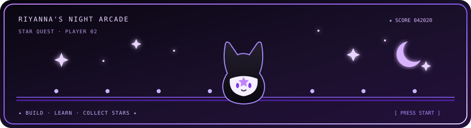

# ✦ Hey, I'm Yanna ✦

### ☾ WHISPERS · WISHES · WONDER ☾

**✧･ﾟ: *✧･ﾟ:*  lost somewhere between the void and the constellations  *:･ﾟ✧*:･ﾟ✧**

---

## ☾ 01 / THE OBSERVER · Signals from the Dark

| ✦ **SIGNAL** | **BEYOND THE VEIL** ✧ |
|:---|:---|
| 💜 **Create** | Giving form to ideas found in the dark |
| 🌑 **Seek** | Following questions with no clear answers |
| ✨ **Drift** | Wandering where the known world fades|
| 🖤 **Remain** | Quiet beneath a sky that never ends |

## ✦ 02 / THE UNKNOWN · A Path Through the Stars

> **Main quest:** Follow the faintest stars into the unknown, and leave a trace of light behind. ★

- ✧ **Level 01 — Listen:** hear the whispers hidden in the dark
- 💜 **Level 02 — Wander:** lose your way among the constellations
- ✨ **Level 03 — Discover:** find what the silence has concealed
- ★ **Level 04 — Vanish:** become one more mystery in the endless sky

## 🎀 03 / STAR SIGILS · A Mind Still Becoming

   

*Fragments gathered from distant worlds: half-formed ideas, strange discoveries, and things not yet understood.*

## 🌌 04 / THE VOID · Lights Left Behind

Every commit is a signal cast into the dark. Some lights fade. Others travel farther than expected. ✧ Explore my [repositories](https://github.com/ryyamargaux?tab=repositories) and the stars below. ✦

## 💜 05 / WHISPERS FROM THE VOID · Truths Beneath the Stars

- ✦ To wander beneath the stars is to belong to the unknown.
- ✧ Perhaps being lost is another way of finding the universe.
- ★ Be the star that survives the death of its constellation.
  

### ✧･ﾟ: *✧･ﾟ:* You’ve wandered far enough. Something is waiting beyond the stars. *:･ﾟ✧*:･ﾟ✧

